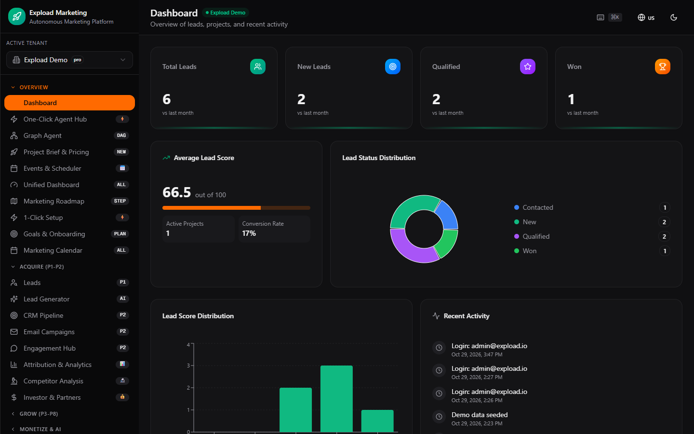
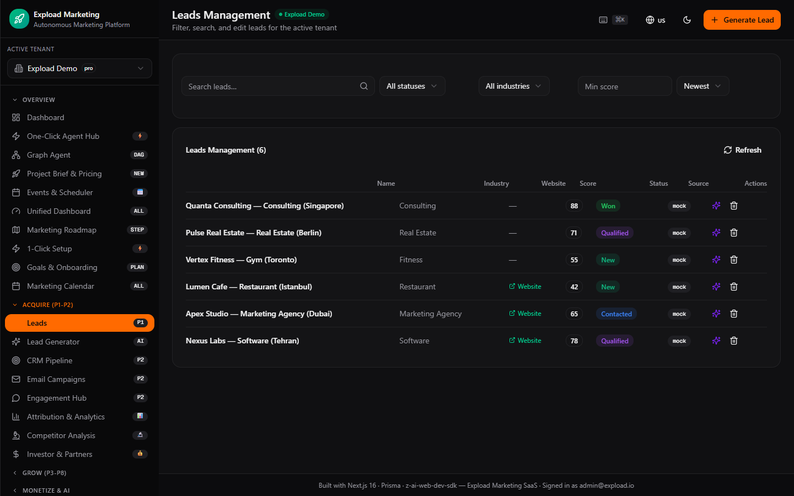
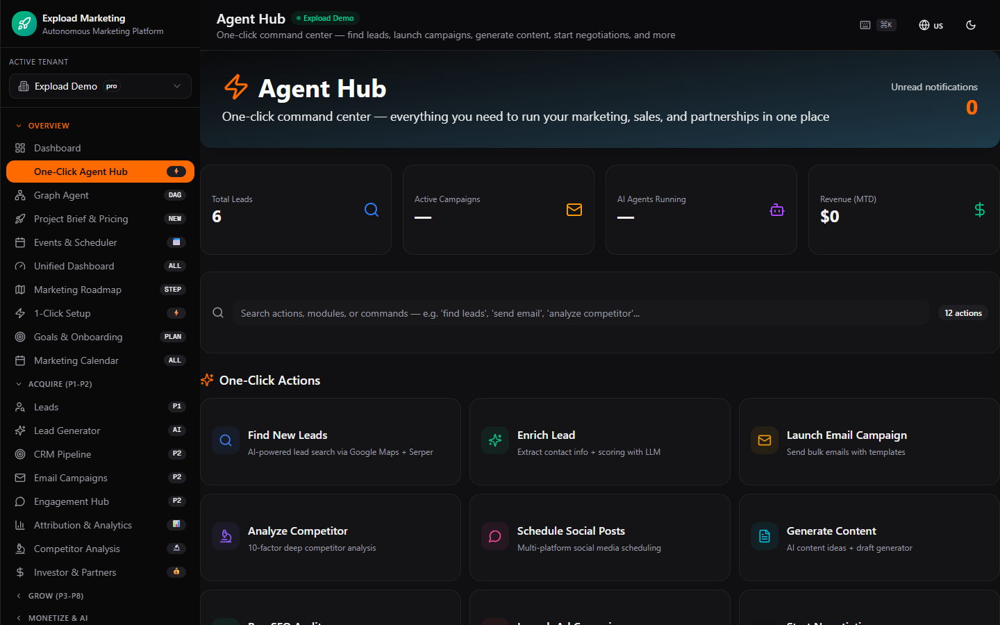

# Expload Marketing

**A multi-tenant, multi-language B2B marketing SaaS: lead generation, CRM, campaigns, SEO and content tooling, and an AI agent layer, in one Next.js app.**

> **Status: not production-ready.** The latest full-system audit
> ([PRODUCTION-READINESS.md](PRODUCTION-READINESS.md)) gives a **NOT READY** verdict, with open
> blockers listed. Several integrations are stubs that return realistic-looking but fake data (see
> [What is real vs. stubbed](#what-is-real-vs-stubbed)). Treat this as an advanced prototype.



## Screenshots

| Landing page | Leads management |
|---|---|
|  |  |

| One-Click Agent Hub |
|---|
|  |

*Captured from the app running locally (`next build` + `next start`, SQLite) after `bun run db:seed`
and signing in to the seeded demo tenant. No external API keys were configured, so nothing on
screen came from a real third-party service. All companies and leads are demo seed data.*

## What it does

- **Acquire**: lead management, an AI lead generator, CRM pipeline, email campaigns, engagement hub,
  attribution & analytics, competitor analysis
- **Grow**: SEO, content, social, ads, growth tooling, marketing calendar and roadmap
- **Monetize & AI**: AI advisor, negotiation, graph agent, autonomous workflows, marketplace,
  reseller / distributor and white-label programs
- **System**: multi-tenant workspaces, team management, approvals, webhooks, payment-gateway and
  LLM-provider settings, a super-admin console

The app is a single-page dashboard: all 62 views are code-split and switched client-side inside
`src/app/page.tsx` ([FRONTEND-ARCHITECTURE.md](FRONTEND-ARCHITECTURE.md)).

## What is real vs. stubbed

Summarized from [PROJECT-INVENTORY.md](PROJECT-INVENTORY.md) and
[KNOWN-ISSUES.md](KNOWN-ISSUES.md). Those files are the source of truth.

**Real:** multi-tenant CRM / lead / campaign / content / SEO / social CRUD on Prisma models;
custom signed-cookie sessions with tenant isolation; a multi-provider LLM aggregator (Groq,
Cerebras, OpenRouter, Mistral, Hugging Face) with quota tracking and fallback; Serper.dev / Google
Maps lead discovery with a deterministic mock fallback; SMTP email (console fallback in dev);
NOWPayments crypto payments with signature-verified webhooks; Redis job queue and Qdrant vector
search, each with in-process fallbacks; i18n across 29 locales.

**Stubbed or simulated:** most card / wallet payment gateways other than NOWPayments; crypto exchange
rates; the backlink, competitor, social and SEO-crawl "analyzer" endpoints; WhatsApp and SMS
delivery (data model and UI only, no outbound provider).

## Tech stack

Next.js 16 (App Router) · React 19 · TypeScript · Tailwind CSS 4 · shadcn/ui · Prisma 6 (SQLite in
development, PostgreSQL schema for production) · Zustand · TanStack Query · next-intl · Recharts ·
optional Redis (ioredis) and Qdrant · Bun · Docker Compose + Caddy for deployment.

## Quick start (local development)

Requires Bun (Node.js 20+ also works for most scripts).

```bash
bun install
cp .env.example .env        # set NEXTAUTH_SECRET at minimum; AI/email/payment keys are optional
bun run db:push             # create the SQLite database from prisma/schema.prisma
bun run db:seed             # demo tenant + demo leads; prints the demo admin login
bun run dev                 # http://localhost:3000
```

Without API keys the app falls back to local or mock behavior. See
[README-DEPLOY.md](README-DEPLOY.md) for the full setup and [DEPLOY.md](DEPLOY.md) /
[DEVOPS-DEPLOYMENT.md](DEVOPS-DEPLOYMENT.md) for Docker-based production deployment.

## Testing

```bash
bun test                    # unit tests
bun run test:e2e            # Playwright end-to-end tests
bun run typecheck
bun run lint
```

## Documentation

| Area | Documents |
|---|---|
| Product | [PRD.md](PRD.md) · [USE-CASES.md](USE-CASES.md) · [USER-JOURNEYS.md](USER-JOURNEYS.md) · [SITEMAP.md](SITEMAP.md) |
| Architecture | [ARCHITECTURE-CURRENT.md](ARCHITECTURE-CURRENT.md) · [ARCHITECTURE-TARGET.md](ARCHITECTURE-TARGET.md) · [BACKEND-ARCHITECTURE.md](BACKEND-ARCHITECTURE.md) · [SYSTEM-DIAGRAM.md](SYSTEM-DIAGRAM.md) · [adr/](adr) |
| Status | [PROJECT-INVENTORY.md](PROJECT-INVENTORY.md) · [KNOWN-ISSUES.md](KNOWN-ISSUES.md) · [PRODUCTION-READINESS.md](PRODUCTION-READINESS.md) · [TODO-INVENTORY.md](TODO-INVENTORY.md) |
| Security | [SECURITY.md](SECURITY.md) · [SECURITY-BASELINE.md](SECURITY-BASELINE.md) · [THREAT-MODEL.md](THREAT-MODEL.md) |
| Operations | [README-DEPLOY.md](README-DEPLOY.md) · [OBSERVABILITY.md](OBSERVABILITY.md) · [RELIABILITY-AUDIT.md](RELIABILITY-AUDIT.md) |
