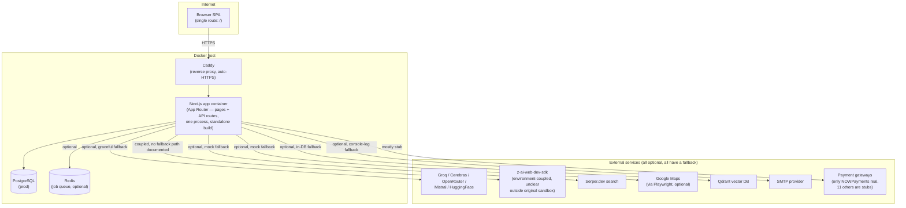
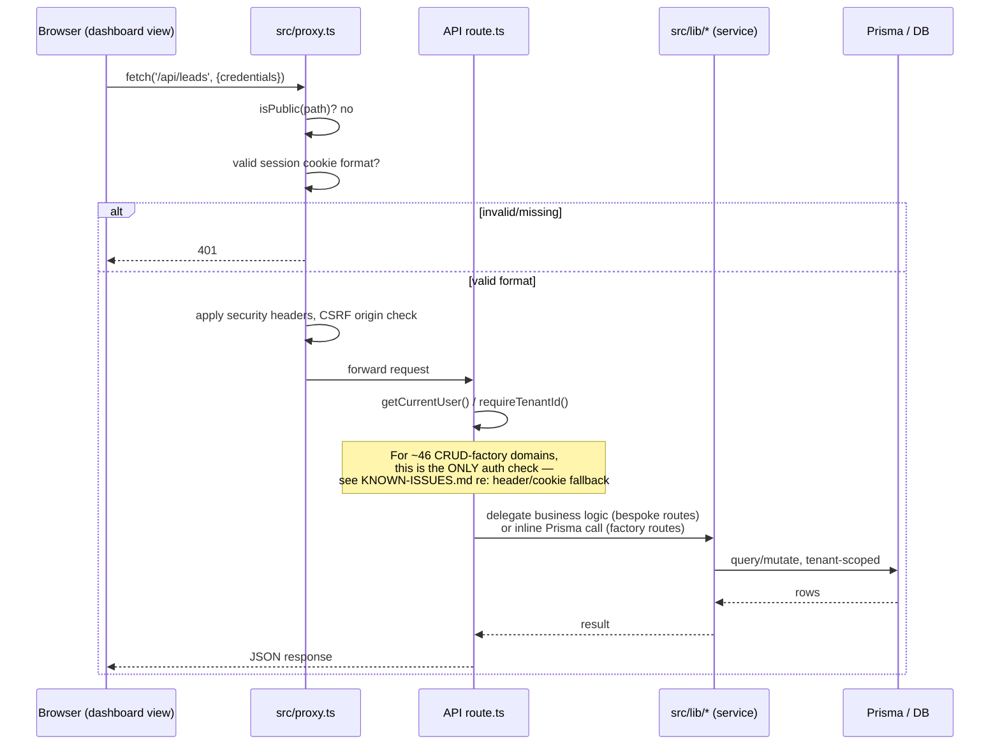
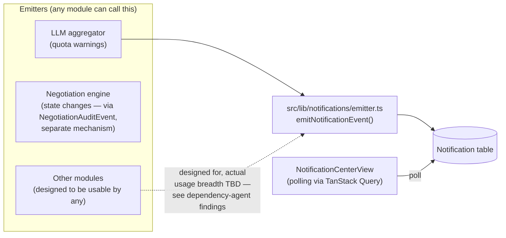
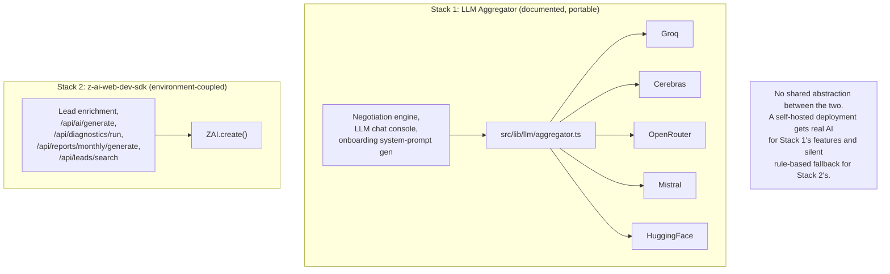

# SYSTEM-DIAGRAM.md — Expload Marketing SaaS

Generated by discovery audit, 2026-09-04, Phase 3 (Architecture Recovery). Diagrams reflect the system **as it currently runs** — a single Next.js deployable, no separate backend service, no microservices. See `ARCHITECTURE-TARGET.md` for what should change and why.

## 1. Deployment topology (current)



**Note**: dev environment uses SQLite (`db/custom.db`) instead of Postgres, and everything else in this diagram is identical — same single process, same optional-external-service pattern.

## 2. Request flow (a typical authenticated API call)



**Key architectural fact**: there is no separate "controller → service → repository" layering enforced consistently. The generic CRUD factory (46 domains) goes route→Prisma directly with no service layer at all. Bespoke routes (the other ~30 domains) sometimes delegate to a `src/lib/` service (negotiation, payroll, LLM, payments) and sometimes contain the business logic inline in the handler itself (see Phase 3 dependency-agent findings for exact examples once available, or `ARCHITECTURE-TARGET.md`).

## 3. Data flow — multi-tenancy

```mermaid
flowchart LR
    subgraph "Tenant A data"
        A1[Leads] --- A2[Deals] --- A3[Campaigns]
    end
    subgraph "Tenant B data"
        B1[Leads] --- B2[Deals] --- B3[Campaigns]
    end
    T[("Tenant row<br/>(id, plan, isActive)")]
    T -->|tenantId FK,<br/>onDelete: Cascade (77 relations)<br/>or SetNull (9 relations)| A1
    T -->|same pattern| B1

    Req["Incoming request"] --> Resolve{"getTenantId()"}
    Resolve -->|"1. session-derived (normal case)"| A1
    Resolve -->|"2. X-Tenant-ID header<br/>(no credential check — see SECURITY-BASELINE.md)"| B1
    Resolve -->|"3. tenant-id cookie<br/>(same gap)"| B1
```

**This diagram makes the tenant-isolation architectural flaw visually explicit**: the same resolver function that's supposed to guarantee "you only ever see your own tenant's data" has two paths (2 and 3) that don't actually verify identity. This is the single most important thing for `ARCHITECTURE-TARGET.md` to resolve.

## 4. Event flow — notification system



**Note**: this is a database-backed event pattern (write to `Notification` table, client polls), not a real pub/sub/message bus — consistent with the project's explicit choice (per `TECHNICAL_SPECIFICATION.md`) to avoid Socket.io and use TanStack Query polling for anything "live."

## 5. AI integration — the two-stack reality



This is the clearest single "architecture problem with a visible product impact" in the system — see `ARCHITECTURE-TARGET.md` for the proposed consolidation.
